# Smartsheet to Microsoft: IT Project & Portfolio Management on Power Platform

[](https://github.com/davilacrSE/smartsheet-to-microsoft-ppm/actions/workflows/ci.yml)
[](https://davilacrse.github.io/smartsheet-to-microsoft-ppm/)
[](https://learn.microsoft.com/power-apps/developer/code-apps/overview)
[](https://learn.microsoft.com/power-apps/maker/data-platform/data-platform-intro)
[](LICENSE)

**A working accelerator for moving an IT PMO off Smartsheet and onto Microsoft.** Project intake, stage gates, project artifacts, resource capacity and portfolio reporting run as one Power Apps code app on Microsoft Dataverse. People use it in the browser or inside Microsoft Teams. Power Automate delivers notifications, and Power BI can report on the same tables.

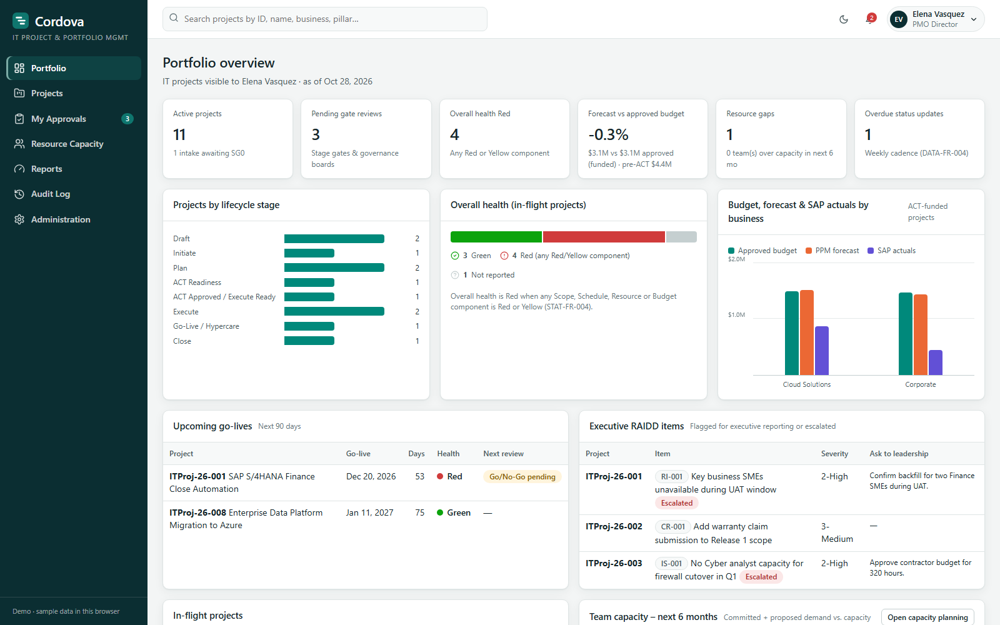

**[Try the live demo](https://davilacrse.github.io/smartsheet-to-microsoft-ppm/)** · [Demo script](docs/demo-script.md) · [Smartsheet to Microsoft mapping](docs/smartsheet-to-microsoft.md) · [Deploy to an environment](docs/deploy.md) · [Tailor it for a customer](docs/customize.md) · [Walkthrough deck](docs/deck/From-Smartsheet-to-Cordova-PPM.pptx)

> **Cordova is a fictional company.** The scenario is modeled on a real IT PMO's move from Smartsheet. Every person, project and number in the sample data is made up.

---

## The scenario

Cordova's IT PMO ran every project in Smartsheet:

- Business Relationship Managers (BRMs) submitted requests through a PPM Intake sheet.
- Approving an intake copied the project templates into a new workspace: **16 sheets and a dashboard folder per project**.
- Every sheet repeated the Project ID and Project Name, and cell links carried values between sheets.
- Gate readiness lived in checklist columns on the Project Record, and gate decisions were rows on an Approvals sheet.
- Resource capacity sat in more sheets that fed a separate Power BI report.

The PMO wanted six things the sheets could not give them:

| Need | What it means |
|---|---|
| One system of record | Intake, governance, status, approvals, forecasts, resource demand and reporting in one place |
| Controlled, auditable workflow | Role-based stage gates instead of sheet-based workflows anyone could edit |
| Artifacts created automatically | The project's artifact set is created the moment the intake is approved |
| Capacity in the same tool | Demand, capacity, nominations, confirmations and what-if scenarios beside the project |
| Portfolio visibility | Stage, health, budget against forecast and actuals, upcoming go-lives and overdue updates |
| Confidential and external work | NDA projects only an approved list can see, and time-bound access for external people |

## Before and after

| | In Smartsheet | On Microsoft |
|---|---|---|
| **Intake** | PPM Intake sheet | BRM-only form with validation and a unique Project ID |
| **Project artifacts** | 16 template sheets copied per project | Dataverse rows created under the project when Stage Gate 0 approves |
| **Linking artifacts** | Project ID on every sheet, plus cell links | One lookup from every artifact row to its project |
| **Gate readiness** | Checklist columns on the Project Record | A configurable checklist that blocks Approve until it is met |
| **Approvals** | Rows on the Approvals sheet | Gate reviews with segregation of duties and recorded exceptions |
| **Status and health** | Weekly Status Tracker sheet | Weekly status with calculated overall health |
| **Resource capacity** | Sheets feeding a Power BI report | Heatmap, nominations, gaps and scenarios in the app |
| **Reporting** | Power BI built on Smartsheet data | Portfolio dashboard and ten reports, with Power BI on the same tables |
| **Audit** | Activity and cell history, sheet by sheet | One audit trail with before and after values |
| **Confidential projects** | Separate sheets and careful sharing | NDA projects hidden from every view for anyone off the access list |
| **External people** | Sheet sharing | Per-artifact access, approved twice, that expires on its own |
| **Where people work** | Smartsheet web and Smartsheet for Teams | Power Apps in the browser and a Microsoft Teams app |

The stages, gates, artifacts and their numbering (0.0 Stakeholder Register through 9.0 Weekly Status Tracker) stayed the same, so the PMO's process did not change. What changed is that it now runs on one data model with enforced rules and one audit trail. The full mapping, including Control Center, Dynamic View and Resource Management, is in [docs/smartsheet-to-microsoft.md](docs/smartsheet-to-microsoft.md).

## See it

| | |
|---|---|
| 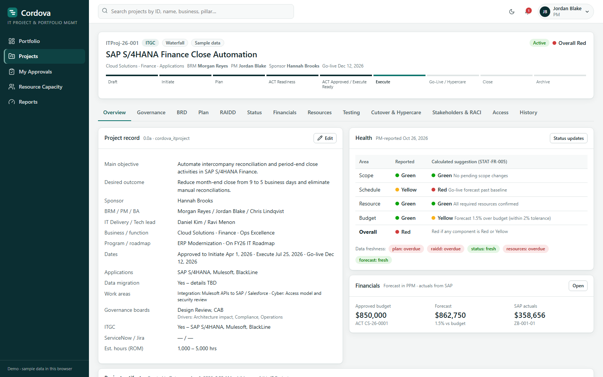 **Project workspace.** One record per project, with the lifecycle stepper, health and financials. | 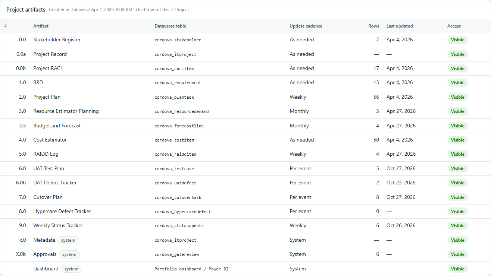 **16 sheets become child rows.** Every artifact is a Dataverse table under the project. |
| 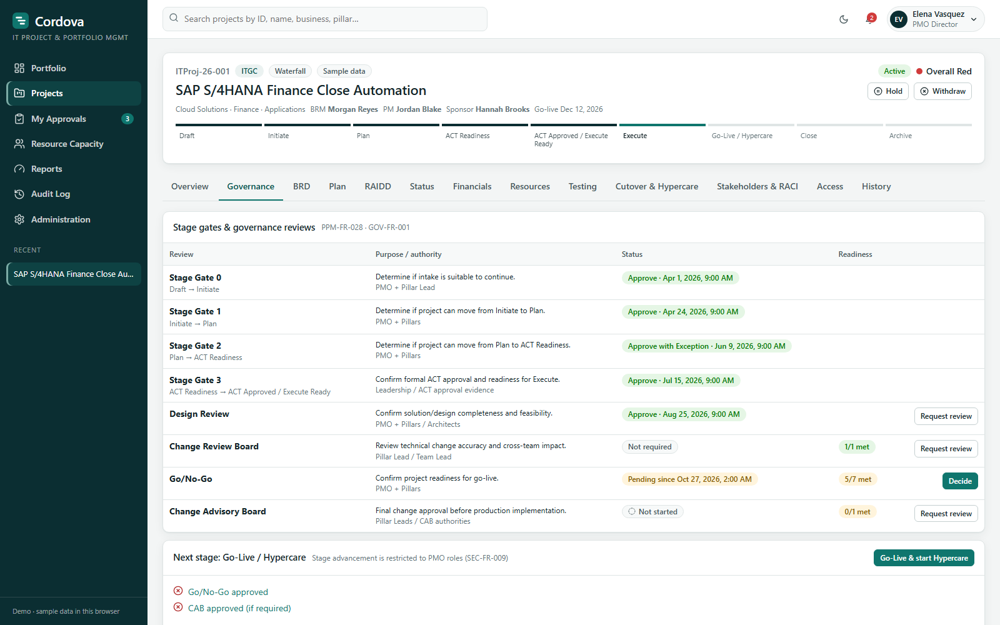 **Stage gates and governance reviews.** Readiness checks run against the project's own records. | 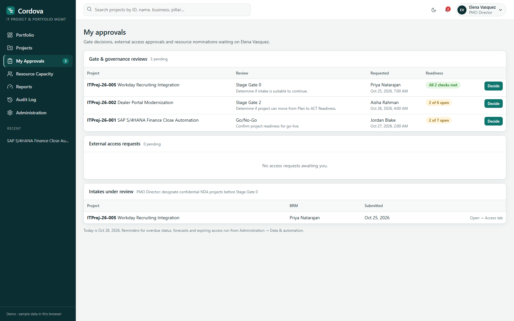 **One approvals inbox.** Gate decisions, external access requests and nominations. |
| 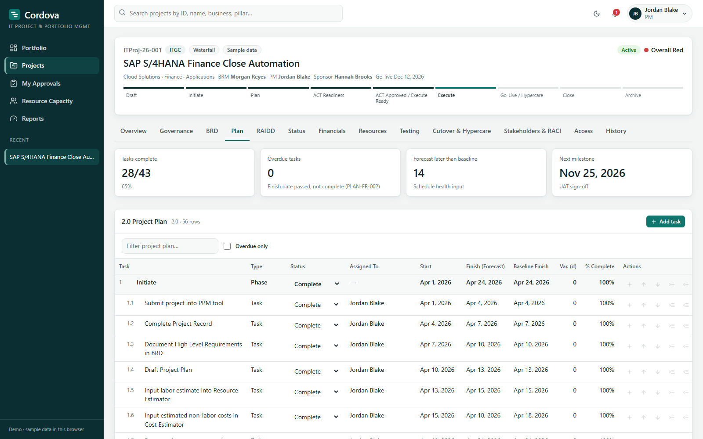 **Project plan.** A WBS generated from the standard template, with baseline and forecast dates. | 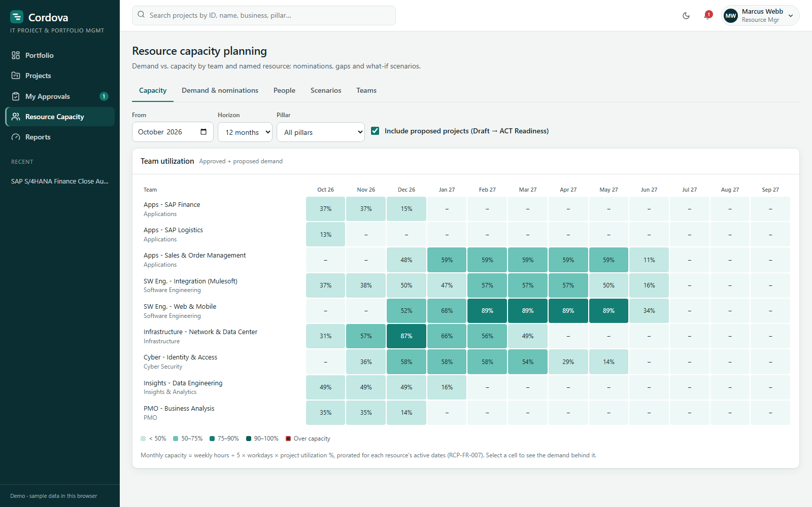 **Resource capacity.** Demand against capacity by team and month. |
| 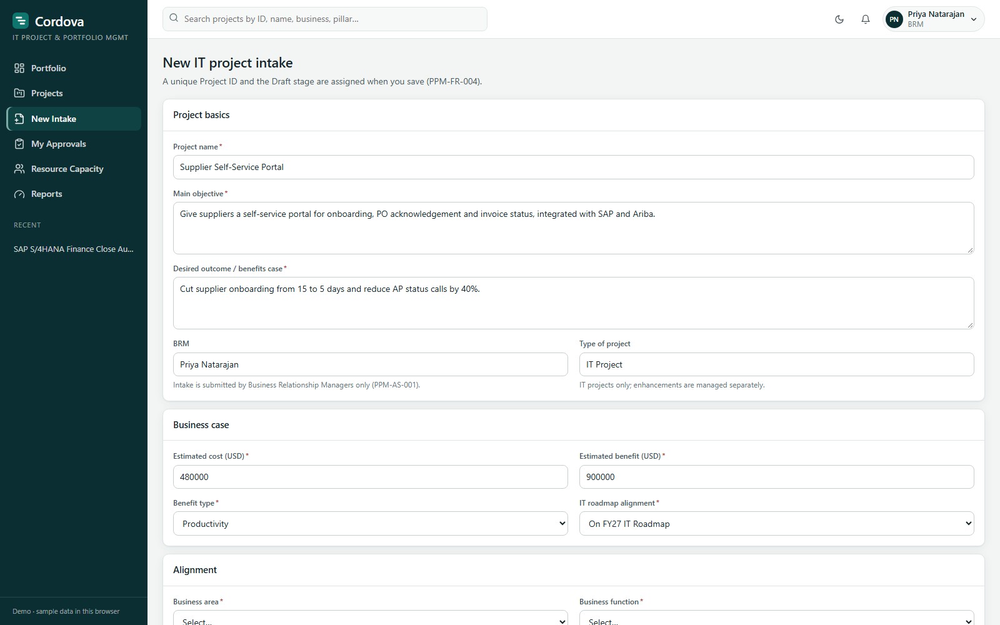 **BRM intake.** Only BRMs can create projects, and the form validates before submit. | 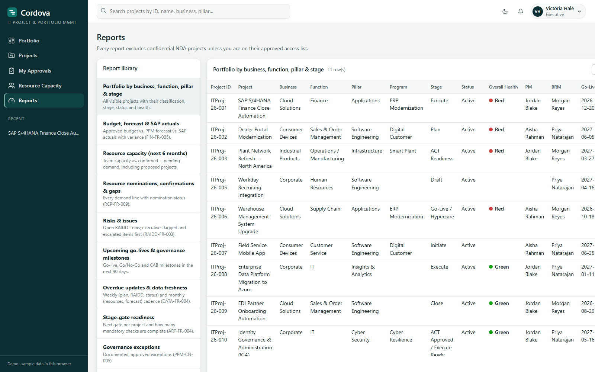 **Reports.** Ten portfolio reports with CSV export, and Power BI on the same data. |
| 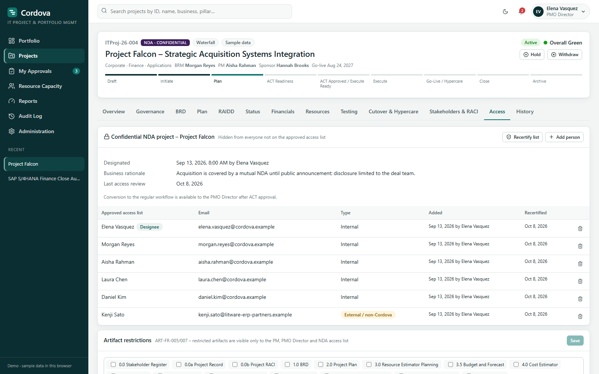 **Confidential NDA projects.** Visible only to the approved access list. | 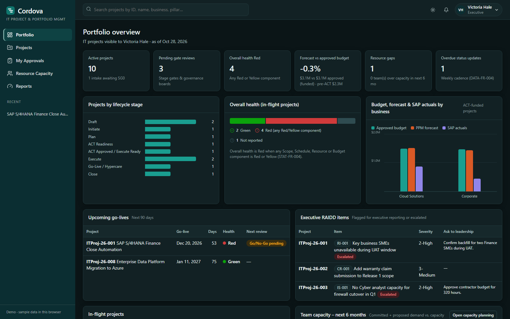 **Dark mode.** Follows the operating system, or the Teams theme inside Teams. |

More screens: [RAIDD log](docs/images/raidd-log.png), [weekly status](docs/images/weekly-status.png), [financials](docs/images/financials.png), [projects list](docs/images/projects.png), [persona switcher](docs/images/persona-switcher.png).

## Try it in two minutes

The demo runs entirely in your browser with sample data. It needs no Microsoft 365 tenant and no Dataverse environment.

```bash
git clone https://github.com/davilacrSE/smartsheet-to-microsoft-ppm.git
cd smartsheet-to-microsoft-ppm
npm install
npm run dev
```

Open http://localhost:3000 and switch personas from the menu at the top right. The sample data has 12 projects across every lifecycle stage, 20 people and about 2,300 artifact rows. Changes you make stay in your browser until you reset them in Administration → Data & automation.

Deep links open the demo as a specific person, which keeps a live demo moving:

| Add to the demo URL | Opens |
|---|---|
| `?as=priya.natarajan#/intake/new` | A BRM creating a new intake |
| `?as=elena.vasquez#/approvals` | The PMO Director's approvals inbox |
| `?as=jordan.blake#/projects/ITProj-26-001/plan` | A project manager in a project plan |
| `?as=marcus.webb#/resources` | A resource manager's capacity heatmap |
| `?as=victoria.hale` | The CIO's read-only portfolio view |
| `?as=dana.whitfield` | An external consultant who sees only two projects |
| `?company=Contoso&primary=%236B2FBA&ink=%231E0B36` | The whole demo in another company's name and colors |

The [demo script](docs/demo-script.md) walks a project from idea to archive in 14 steps, each one showing how it worked in Smartsheet and how it works now.

## Architecture

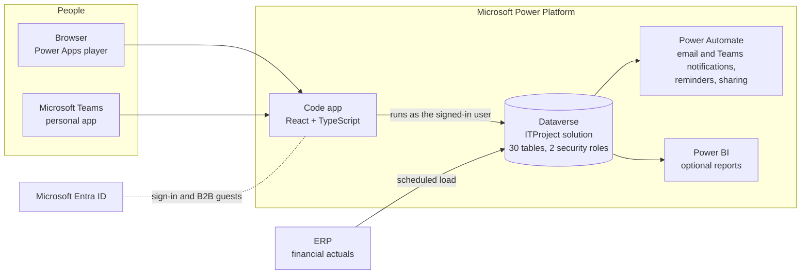

- **The app** is a [Power Apps code app](https://learn.microsoft.com/power-apps/developer/code-apps/overview) built with React 18, TypeScript and Vite. It calls Dataverse through the Power Apps client library as the signed-in user, so Dataverse security decides what each person can read and write. The app enforces the PMO's rules: gate checklists, segregation of duties, health, capacity, NDA visibility and external scope.
- **Dataverse** holds 30 tables in one solution. Each artifact table has a parental lookup to the IT Project table, so a project's artifacts, ownership and sharing travel together.
- **Microsoft Teams** hosts the same app as a personal app. Sign-in and data security work exactly as they do in the browser.
- **Power Automate** turns notification rows into email and Teams messages and runs the daily sweep of reminders and access expiry. **Power BI** reads the same tables for any reporting beyond the built-in reports.

Details, including the data model and security model, are in [docs/architecture.md](docs/architecture.md).

## What's in the box

- **Lifecycle.** Nine stages from Draft to Archive, four stage gates (SG0 to SG3) and four governance reviews: Design Review, Change Review Board, Go/No-Go and Change Advisory Board.
- **Artifacts.** The 16 template artifacts, from 0.0 Stakeholder Register to X.0b Approvals, as Dataverse records under the project. They are created at Stage Gate 0 from standard templates: stakeholder register, RACI, BRD with requirement-to-test traceability, WBS plan, resource estimate, budget and forecast, cost estimate, RAIDD log, UAT plan and defects, cutover, hypercare and weekly status.
- **Roles.** Thirteen application roles, from BRM, PMO Director, PM and Finance to Resource Team Manager, Executive and External Collaborator.
- **Resource capacity.** Teams, named resources and capacity; demand by project; nominations and gaps; what-if scenarios.
- **Finance.** Monthly forecast per capital or expense line against approved budget, with actuals loaded read-only from the ERP.
- **Confidential and external work.** An NDA workflow with an approved access list, and time-bound external access per artifact or workspace.
- **Notifications and audit.** In-app notifications, ready for email and Teams delivery, and a business audit trail with before and after values.
- **Administration.** Users and roles, gate checklists and approvers, master data, thresholds, access review and data tools, all in the app.
- **Quality.** 49 automated workflow checks covering all 18 acceptance criteria. A render test draws every page for every persona, 4,650 renders, and checks that no NDA project leaks into the HTML. CI runs both on every push.

## Deploy to a customer environment

1. Turn on code apps for the environment in the Power Platform admin center.
2. Set the customer's name, colors and Dataverse prefix in [src/brand.ts](src/brand.ts).
3. Run `npm run dataverse:provision` to create the publisher, solution, tables, relationships and security roles. Add `-- --seed` to load the sample projects.
4. Run `pac code init`, then `npm run pac:add-sources` to register the tables with the app.
5. Run `npm run build` and `pac code push --solutionName ITProject`.
6. Optionally, package the Teams app with `npm run teams:package`.

The full guide, including licensing, Teams, flows and production hardening, is [docs/deploy.md](docs/deploy.md).

## Make it the customer's

Everything customer-specific lives in [src/brand.ts](src/brand.ts): company name, app name, colors, logo, email domain, and the Dataverse publisher, prefix and solution. Charts keep their validated, colorblind-safe palette whatever brand you choose.

- **No rebuild for a quick demo.** Add `?company=Northwind&primary=%232563EB&ink=%230B1B3B` to the demo URL.
- **A screenshot pack in their brand.** Run `npm run screenshots -- --company Northwind --primary "#2563EB" --ink "#0B1B3B" --out ./northwind-shots`.

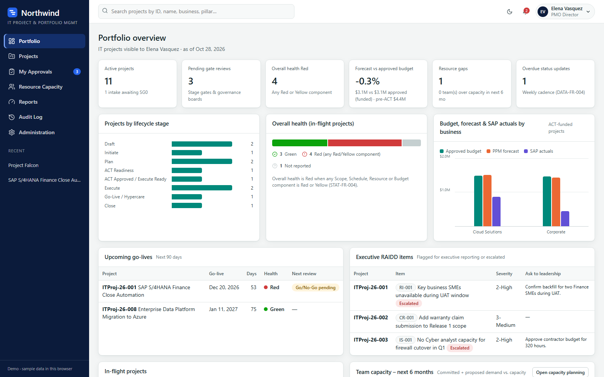

See [docs/customize.md](docs/customize.md) for stages, gates, artifact templates, master data and new columns.

## Repository layout

```
src/brand.ts            Customer name, colors, logo and Dataverse naming
src/data/model.ts       Dataverse model: tables, columns, lookups and row mapping
src/data/dataverse.ts   Dataverse backend (Power Apps client library, runs as the signed-in user)
src/data/mock.ts        Browser-local backend with sample data, for the demo and tests
src/data/seed.ts        Sample data: 12 projects, 20 people, teams and resources
src/domain/             Stages, gates, artifact catalog, field schemas, calculations
src/services/           Rules, workflow, capacity planning, reports, audit and notifications
src/pages/, components/ User interface
dataverse/provision.ts  Creates the publisher, solution, tables, relationships and roles
scripts/                Tests, Dataverse verification, pac helper, screenshot generator
teams/build.ts          Microsoft Teams app package
docs/                   Guides, screenshots and the walkthrough deck
```

## Documentation

| Guide | For |
|---|---|
| [Smartsheet to Microsoft](docs/smartsheet-to-microsoft.md) | Capability mapping, the six-step move and options for in-flight projects |
| [Demo script](docs/demo-script.md) | A 15-minute and a full 14-step walkthrough with personas and deep links |
| [Architecture](docs/architecture.md) | Components, data model, security model and requirement IDs |
| [Deploy](docs/deploy.md) | Provisioning Dataverse, publishing the code app, Teams, flows and hardening |
| [Customize](docs/customize.md) | Branding, naming, terminology, templates and new columns |
| [FAQ](docs/faq.md) | Licensing, Teams, security, Power BI and common questions |

## Notes

This repository is a sample accelerator, provided as-is under the [MIT license](LICENSE). It is not a Microsoft product or a supported service. Smartsheet is a trademark of Smartsheet Inc. Microsoft, Power Apps, Power Automate, Power BI, Dataverse and Microsoft Teams are trademarks of the Microsoft group of companies.
