# Architecture

## Components

| Component | Role |
|---|---|
| **Power Apps code app** | React 18, TypeScript and Vite. All screens and the workflow rules: gate checks, segregation of duties, health, capacity, NDA visibility and external scope |
| **Microsoft Dataverse** | The system of record: 30 tables in one solution, with two security roles and table auditing |
| **Microsoft Entra ID** | Sign-in, the organization directory behind the people picker, and B2B guests for external people |
| **Microsoft Teams** | Hosts the same code app as a personal app |
| **Power Automate** | Delivers notifications by email and Teams, runs the daily sweep, and shares or revokes records for NDA and external access |
| **Power BI** | Optional reporting on the same tables. The dashboard can link to a report |
| **ERP** | Stays the system of record for financial actuals, loaded on a schedule into Dataverse |

The app calls Dataverse through the Power Apps client library (`@microsoft/power-apps`), which runs every request as the signed-in user. Dataverse security roles and record ownership therefore decide what each person can read and write, and the app's rules sit on top.

The same app has two backends behind one interface in [src/data/store.ts](../src/data/store.ts):

- [src/data/dataverse.ts](../src/data/dataverse.ts) talks to Dataverse in the deployed app.
- [src/data/mock.ts](../src/data/mock.ts) keeps sample data in the browser for the demo and the tests. It behaves like Dataverse where it matters, including server-assigned Project IDs and timestamps.

## Data model

[src/data/model.ts](../src/data/model.ts) is the single definition of every table, column and lookup. The provisioning script creates tables from it, and the app maps rows to and from Dataverse with it at runtime. Run `npm run dataverse:plan` to print the whole model: 30 tables, 422 columns and 49 relationships.

```mermaid
erDiagram
  PPMUSER ||--o{ ITPROJECT : "BRM, PM, sponsor, leads"
  ITPROJECT ||--o{ STAKEHOLDER : "0.0 register"
  ITPROJECT ||--o{ RACIITEM : "0.0b RACI"
  ITPROJECT ||--o{ REQUIREMENT : "1.0 BRD"
  REQUIREMENT ||--o{ REQUIREMENTTRACE : "traced by"
  TESTCASE ||--o{ REQUIREMENTTRACE : "covers"
  ITPROJECT ||--o{ PLANTASK : "2.0 plan"
  ITPROJECT ||--o{ RESOURCEDEMAND : "3.0 demand"
  RESOURCETEAM ||--o{ RESOURCEDEMAND : "requested from"
  ITPROJECT ||--o{ FORECASTLINE : "3.5 budget"
  FORECASTLINE ||--o{ FORECASTENTRY : "monthly forecast"
  ITPROJECT ||--o{ FINANCIALACTUAL : "ERP actuals"
  ITPROJECT ||--o{ COSTITEM : "4.0 cost estimate"
  ITPROJECT ||--o{ RAIDDITEM : "5.0 RAIDD"
  ITPROJECT ||--o{ TESTCASE : "6.0 UAT plan"
  TESTCASE ||--o{ UATDEFECT : "6.0b defects"
  ITPROJECT ||--o{ CUTOVERTASK : "7.0 cutover"
  ITPROJECT ||--o{ HYPERCAREDEFECT : "8.0 hypercare"
  ITPROJECT ||--o{ STATUSUPDATE : "9.0 weekly status"
  ITPROJECT ||--o{ GATEREVIEW : "X.0b approvals"
  ITPROJECT ||--o{ GOVERNANCEEXCEPTION : "exceptions"
  ITPROJECT ||--o{ NDAACCESS : "NDA access list"
  ITPROJECT ||--o{ ACCESSGRANT : "external access"
  ITPROJECT ||--o{ INTAKEATTACHMENT : "intake uploads"
  RESOURCETEAM ||--o{ TEAMASSIGNMENT : "members"
  RESOURCE ||--o{ TEAMASSIGNMENT : "assigned to"
```

The diagram leaves out the people lookups on artifact rows, the self-lookups that give plans, requirements and cost items their hierarchy, and four tables outside the project hierarchy: notifications, audit events, settings and capacity scenarios.

Conventions:

- **The project owns its artifacts.** 21 tables have a parental lookup to IT Project. Assigning, sharing or deleting a project cascades to all of its rows, which is what makes NDA restriction and cleanup work.
- **Value lists are data, not schema.** Stage, status, health and type values are text columns validated by the app, so administrators change lists in the app without a solution deployment.
- **People are lookups.** Sponsor, PM, BA, leads, requirement owners and every "Assigned To" column point to a PPM user profile. The people picker searches PPM profiles and the environment's Users table, which Dataverse keeps in sync with Entra ID. Picking someone without a profile creates one.
- **Project IDs are autonumbers.** Dataverse assigns `ITProj-{yy}-{nnn}` when the project is created.
- **Rows carry client-generated IDs**, so cross-references stay stable when many rows are created at once.
- **Every table has Dataverse auditing turned on.**

## Security model

**Dataverse security roles** grant table access. The provisioning script creates two:

| Role | Access |
|---|---|
| *App name* User | Organization-level access to the PPM tables. Audit events are create and read only, so users cannot edit or delete the audit trail. Settings are read-only. User profiles allow read and create |
| *App name* Administrator | Full rights on every PPM table |

Assign people **Basic User** plus the User role. Administrators also get the Administrator role.

**Application roles** live on the PPM user profile and drive the workflow rules:

- Only BRMs create intakes, and a BRM cannot edit an intake after submitting it.
- Segregation of duties: the requester and the project's own BRM or PM cannot approve its gates.
- Stage advancement is limited to the PMO and authorized approvers.
- Finance fields are limited to the PM and Finance, and WBS and PO fields open after funding approval.
- Resource Team Managers nominate people or declare gaps for their teams.
- Executives are read-only. External collaborators see only what they were granted, until it expires.

A signed-in user with no PPM profile sees "Access not provisioned". In the deployed app, System Administrators can test as another persona; this is audited, and Dataverse still evaluates the administrator's own permissions.

### Confidential NDA projects

The PMO Director can move an intake into a confidential parallel workflow. Until it is converted, an NDA project is hidden from every view, search, report, notification and recent list for anyone off its access list. The render test checks this by rendering every page for every persona and searching the HTML for the project's name and codename.

The app enforces this today. For enforcement at the data layer as well, see [deploy.md](deploy.md#harden-for-production): owner teams in a restricted business unit, synced from the access list by a flow.

### External access

External people are invited as Entra B2B guests. A grant covers one project, either the whole workspace or selected artifacts, with View or Edit permission and a mandatory expiry date. The sponsor or owner approves first, then an administrator. A daily sweep expires grants, and a flow shares or revokes the Dataverse records as grants change.

## Notifications and automation

The app writes notification rows: gate requests, decisions, nominations, escalations, reminders and access events. Each row lists its channels. A Power Automate flow triggered on new rows sends the email or Teams message, and in-app notifications work without it.

The daily sweep covers overdue status and forecasts, go-live, Go/No-Go and CAB alerts, resource gap alerts and grant expiry. Until a scheduled flow runs it, Administration → Data & automation → **Run now** performs the sweep on demand.

## Hosting in Microsoft Teams

[teams/build.ts](../teams/build.ts) packages a Teams personal app whose tab loads the deployed app through the documented [code app embed URL](https://learn.microsoft.com/power-apps/developer/code-apps/how-to/embed-iframe). The tab adds `ppmhost=teams` and the Teams theme, so the app follows the Teams light or dark theme.

- **Do not add `source=teamstab` to the tab URL.** It switches the Power Apps player to its canvas app sign-in for Teams, which fails for code apps.
- **Allow Teams to frame the app.** The environment's code app content security policy must list the Teams origins in `frame-ancestors`. See [deploy.md](deploy.md#microsoft-teams).

## Requirement IDs in the code

Comments and tests cite the IDs of the business requirements the build implements, for example `PPM-FR-030` or `AC-007`. They make it easy to trace a rule back to the requirement behind it.

| Prefix | Area |
|---|---|
| `PPM` | Intake, lifecycle, stages and status |
| `ART` | Project artifacts |
| `PLAN`, `BRD`, `RAIDD`, `STAT` | Plan, requirements, RAIDD and weekly status |
| `RCP` | Resource capacity planning |
| `FIN` | Budget, forecast and actuals |
| `GOV` | Governance reviews and exceptions |
| `SEC` | Role-based security |
| `NDA`, `EXT` | Confidential projects and external access |
| `NOT`, `AUD`, `RPT` | Notifications, audit and reporting |
| `DATA`, `INT`, `NFR` | Data rules, integrations and non-functional requirements |
| `OD` | Open decisions |
| `AC` | Acceptance criteria |

## Tests

| Command | What it checks |
|---|---|
| `npm test` | 49 end-to-end workflow checks against the in-memory backend, mapped to the 18 acceptance criteria |
| `npm run test:render` | Renders every page and tab for every persona against the sample data, and checks for NDA leaks |
| `npm run typecheck` | TypeScript across the app and the scripts |
| `npm run dataverse:verify` | Reads every table from a live environment through the app's mapping and runs a write round trip. Needs the sample data |

CI runs the first three, plus both builds, on every push and pull request.
